  
  
  

<picture><source media="(prefers-color-scheme: dark)" srcset="./assets/titulo-proyectos-dark.svg" /></picture>

  
  

  
  

También hice: [Vitrina](https://github.com/Facu-Basualdo/CatalogoTienda) · [El Precioso](https://github.com/Facu-Basualdo/ElPreciosoTiendaWeb) · [Gestor de Estudios](https://github.com/Facu-Basualdo/GestorDeEstudios) · [mods de Minecraft](https://github.com/search?q=user%3AFacu-Basualdo+topic%3Afabric-mod&type=repositories)

<picture><source media="(prefers-color-scheme: dark)" srcset="./assets/titulo-stack-dark.svg" /></picture>

<picture><source media="(prefers-color-scheme: dark)" srcset="./assets/stack-dark.svg" /></picture>

<picture><source media="(prefers-color-scheme: dark)" srcset="./assets/titulo-actividad-dark.svg" /></picture>

<picture>
  <source media="(prefers-color-scheme: dark)" srcset="https://raw.githubusercontent.com/Facu-Basualdo/Facu-Basualdo/output/github-contribution-grid-snake-dark.svg" />
  
</picture>

<!-- Generado con scripts/generar.py: editá los datos ahí y volvé a correrlo. -->
