<picture><source media="(prefers-color-scheme: dark)" srcset="./assets/presentacion-dark.svg" /></picture>

  <a href="mailto:facundo@basualdo.dev"><picture><source media="(prefers-color-scheme: dark)" srcset="./assets/boton-email-dark.svg" /></picture></a>
  <a href="https://basualdo.dev"><picture><source media="(prefers-color-scheme: dark)" srcset="./assets/boton-web-dark.svg" /></picture></a>
  <a href="https://www.linkedin.com/in/facu-basualdo/"><picture><source media="(prefers-color-scheme: dark)" srcset="./assets/boton-linkedin-dark.svg" /></picture></a>

### 📌 Proyectos

  
  

  
  

También hice: [Vitrina](https://github.com/Facu-Basualdo/CatalogoTienda) · [El Precioso](https://github.com/Facu-Basualdo/ElPreciosoTiendaWeb) · [Gestor de Estudios](https://github.com/Facu-Basualdo/GestorDeEstudios) · [mods de Minecraft](https://github.com/search?q=user%3AFacu-Basualdo+topic%3Afabric-mod&type=repositories)

### 🧰 Stack

<picture><source media="(prefers-color-scheme: dark)" srcset="./assets/stack-dark.svg" /></picture>

### 🐍 Actividad

<picture>
  <source media="(prefers-color-scheme: dark)" srcset="https://raw.githubusercontent.com/Facu-Basualdo/Facu-Basualdo/output/github-contribution-grid-snake-dark.svg" />
  
</picture>

<!-- Generado con scripts/generar.py: editá los datos ahí y volvé a correrlo. -->
