<a href="https://basualdo.dev"><picture><source media="(prefers-color-scheme: dark)" srcset="./assets/hero-dark.svg" /></picture></a>

  <a href="https://basualdo.dev"><picture><source media="(prefers-color-scheme: dark)" srcset="./assets/boton-portafolio-dark.svg" /></picture></a>
  <a href="https://basualdo.dev/cv-facundo-basualdo.pdf"><picture><source media="(prefers-color-scheme: dark)" srcset="./assets/boton-cv-dark.svg" /></picture></a>
  <a href="https://www.linkedin.com/in/facu-basualdo/"><picture><source media="(prefers-color-scheme: dark)" srcset="./assets/boton-linkedin-dark.svg" /></picture></a>
  <a href="mailto:facundo@basualdo.dev"><picture><source media="(prefers-color-scheme: dark)" srcset="./assets/boton-email-dark.svg" /></picture></a>

<picture><source media="(prefers-color-scheme: dark)" srcset="./assets/seccion-proyectos-dark.svg" /></picture>

  <a href="https://mifacu.com.ar"><picture><source media="(prefers-color-scheme: dark)" srcset="./assets/proyecto-mifacu-dark.svg" /></picture></a>
  <a href="https://github.com/Facu-Basualdo/Juegachos"><picture><source media="(prefers-color-scheme: dark)" srcset="./assets/proyecto-juegachos-dark.svg" /></picture></a>

  <a href="https://github.com/Facu-Basualdo/Brillo"><picture><source media="(prefers-color-scheme: dark)" srcset="./assets/proyecto-brillo-dark.svg" /></picture></a>
  <a href="https://www.arcosoftware.com.ar/"><picture><source media="(prefers-color-scheme: dark)" srcset="./assets/proyecto-arco-dark.svg" /></picture></a>

  <a href="https://github.com/Facu-Basualdo/CatalogoTienda"><picture><source media="(prefers-color-scheme: dark)" srcset="./assets/proyecto-vitrina-dark.svg" /></picture></a>
  <a href="https://github.com/Facu-Basualdo/ElPreciosoTiendaWeb"><picture><source media="(prefers-color-scheme: dark)" srcset="./assets/proyecto-el-precioso-dark.svg" /></picture></a>

  <a href="https://github.com/Facu-Basualdo/GestorDeEstudios"><picture><source media="(prefers-color-scheme: dark)" srcset="./assets/proyecto-gestor-de-estudios-dark.svg" /></picture></a>
  <a href="https://github.com/search?q=user%3AFacu-Basualdo+topic%3Afabric-mod&type=repositories"><picture><source media="(prefers-color-scheme: dark)" srcset="./assets/proyecto-mods-minecraft-dark.svg" /></picture></a>

<picture><source media="(prefers-color-scheme: dark)" srcset="./assets/seccion-experiencia-dark.svg" /></picture>

<picture><source media="(prefers-color-scheme: dark)" srcset="./assets/experiencia-dark.svg" /></picture>

<picture><source media="(prefers-color-scheme: dark)" srcset="./assets/seccion-stack-dark.svg" /></picture>

<picture><source media="(prefers-color-scheme: dark)" srcset="./assets/stack-dark.svg" /></picture>

<picture><source media="(prefers-color-scheme: dark)" srcset="./assets/seccion-actividad-dark.svg" /></picture>

<picture>
  <source media="(prefers-color-scheme: dark)" srcset="https://raw.githubusercontent.com/Facu-Basualdo/Facu-Basualdo/output/github-contribution-grid-snake-dark.svg" />
  
</picture>

<picture><source media="(prefers-color-scheme: dark)" srcset="./assets/seccion-contacto-dark.svg" /></picture>

<a href="mailto:facundo@basualdo.dev"><picture><source media="(prefers-color-scheme: dark)" srcset="./assets/contacto-dark.svg" /></picture></a>

  <a href="https://basualdo.dev/cv-facundo-basualdo.pdf"><picture><source media="(prefers-color-scheme: dark)" srcset="./assets/boton-cv-dark.svg" /></picture></a>
  <a href="https://www.linkedin.com/in/facu-basualdo/"><picture><source media="(prefers-color-scheme: dark)" srcset="./assets/boton-linkedin-dark.svg" /></picture></a>
  <a href="mailto:facundo@basualdo.dev"><picture><source media="(prefers-color-scheme: dark)" srcset="./assets/boton-email-dark.svg" /></picture></a>

<!-- Generado con scripts/generar.py: editá los datos ahí y volvé a correrlo. -->
